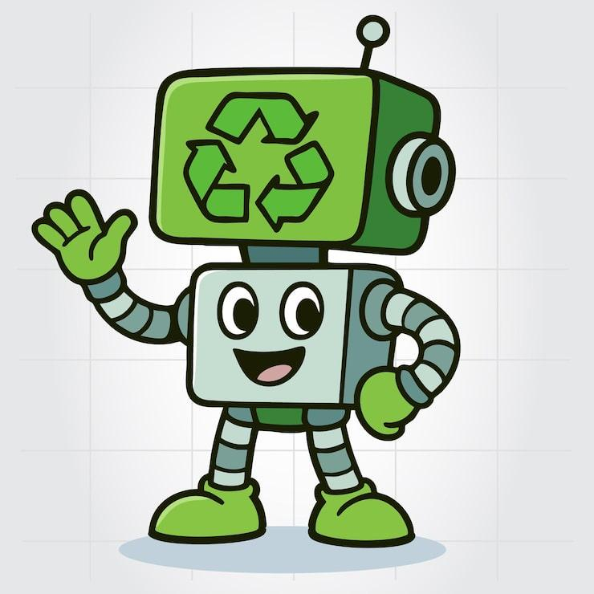

# 🌱 GreenBot — Il bot per proteggere il pianeta
<p align="center">
    
</p>
GreenBot è un progetto didattico realizzato con Python e `discord.py`. Aiuta a parlare di sostenibilità, riduzione dell'inquinamento e corretta gestione dei rifiuti attraverso consigli, sfide e informazioni sullo smaltimento.

Questo progetto è pensato per gli studenti di Kodland: permette di esercitarsi con **liste, dizionari, moduli, funzioni, condizioni, importazioni e comandi asincroni**.

## 📋 Indice

- [Cosa può fare GreenBot](#-cosa-può-fare-greenbot)
- [Struttura dei file](#-struttura-dei-file)[text](../../../../Downloads/README.md)
- [Come funziona il codice](#-come-funziona-il-codice)
- [Comandi disponibili](#-comandi-disponibili)
- [Configurazione](#-configurazione)
- [Installazione e avvio](#-installazione-e-avvio)
- [Problemi comuni](#-problemi-comuni)
- [Idee per migliorare il progetto](#-idee-per-migliorare-il-progetto)

## 🌍 Cosa può fare GreenBot

- Invia un consiglio ecologico casuale.
- Propone una sfida per compiere un'azione sostenibile.
- Fornisce indicazioni sullo smaltimento di diversi rifiuti.
- Mostra l'elenco dei comandi con `$info`.
- Quando si collega a Discord, può inviare un messaggio di benvenuto, un'immagine e l'elenco dei comandi nel canale configurato.

## 📁 Struttura dei file

Organizza il progetto in questo modo:

```text
GreenBot/
├── main.py
├── settings.py
├── consigli.py
├── sfide.py
├── riciclo.py
└── images/
    └── green_bot.png
```

- **`main.py`**: contiene il codice principale del bot.
- **`settings.py`**: contiene il token, il prefisso dei comandi e l'ID del canale.
- **`consigli.py`**: contiene la lista `consigli`.
- **`sfide.py`**: contiene la lista `sfide`.
- **`riciclo.py`**: contiene il dizionario `riciclo`, con le informazioni sullo smaltimento.
- **`images/`**: contiene l'immagine da inviare su Discord.

I nomi dei file e delle variabili devono corrispondere a quelli usati negli `import`.

## 🧠 Come funziona il codice

### 1. Importare le librerie

```python
import random
import os
import requests
import discord

from discord.ext import commands
from consigli import consigli
from sfide import sfide
from riciclo import riciclo
from settings import settings
```

- `random` sceglie un elemento casuale da una lista.
- `os` permette di lavorare con cartelle e file.
- `discord` e `discord.ext.commands` servono a creare il bot e i suoi comandi.
- `consigli`, `sfide` e `riciclo` sono dati definiti nei nostri file Python.
- `requests` serve per effettuare richieste HTTP, ma nel codice attuale non viene utilizzato: puoi rimuovere l'import se non ti serve.

In questa versione usiamo `from settings import settings`, quindi `settings.py` deve definire un dizionario chiamato `settings`.

### 2. Configurare il bot

```python
intents = discord.Intents.default()
intents.message_content = True

bot = commands.Bot(
    command_prefix=settings['PREFIX'],
    intents=intents
)
```

- **Intent**: indica quali eventi e dati Discord può rendere disponibili al bot.
- `message_content = True` abilita la lettura del contenuto dei messaggi necessaria per i comandi con prefisso.
- `command_prefix` definisce il simbolo iniziale dei comandi, per esempio `$`.

Nel [Discord Developer Portal](https://discord.com/developers/applications), apri l'applicazione del bot e abilita anche **Message Content Intent** nella sezione **Bot**, se richiesto.

### 3. Preparare il messaggio informativo

La variabile `comandi` contiene il testo che spiega come utilizzare GreenBot. La stessa variabile viene riutilizzata all'avvio e con il comando `$info`: così non è necessario scrivere il messaggio due volte.

```python
comandi = '''
🌱 **GreenBot — Comandi disponibili**

`$consiglio` → visualizza un consiglio
`$sfida` → visualizza la sfida del giorno
`$smaltimento carta` → informazioni sullo smaltimento
`$info` → mostra questa guida

Categorie: carta, plastica, vetro, alluminio,
pile, organico, farmaci, elettronica, vestiti, olio.
'''
```

Discord interpreta il testo Markdown come `**grassetto**` e i caratteri tra backtick come codice.

### 4. L'evento `on_ready()`

```python
@bot.event
async def on_ready():
    print(f'Bot online: {bot.user}')
```

`on_ready()` viene eseguito quando il bot si è collegato a Discord ed è pronto. Non riceve `ctx`: il contesto `ctx` è invece disponibile dentro le funzioni dei comandi.

Per inviare immagine e informazioni, il bot deve conoscere l'ID del canale e avere il permesso di inviare messaggi e allegati. Per evitare errori, il file immagine deve esistere e la cartella `images` deve contenere almeno un'immagine supportata.

> **Attenzione:** `on_ready()` può essere eseguito più volte in caso di riconnessione. Senza un controllo aggiuntivo, il messaggio di benvenuto potrebbe essere inviato più volte. Inoltre `bot.get_channel()` può restituire `None`: in tal caso controlla l'ID del canale e, se necessario, recuperalo con `await bot.fetch_channel(channel_id)`.

### 5. I comandi

#### `$consiglio`

```python
@bot.command()
async def consiglio(ctx):
    messaggio = random.choice(consigli)
    await ctx.send(f'Consiglio ecologico: {messaggio}')
```

1. `@bot.command()` registra la funzione come comando.
2. `random.choice(consigli)` sceglie un elemento casuale.
3. `ctx.send(...)` invia la risposta nel canale in cui è stato usato il comando.

#### `$sfida`

```python
@bot.command()
async def sfida(ctx):
    sfida_casuale = random.choice(sfide)
    await ctx.send(f'Sfida del giorno: {sfida_casuale}')
```

Il funzionamento è simile a `$consiglio`, ma usa la lista importata da `sfide.py`. Usiamo il nome `sfida_casuale` per non confonderlo con il nome del comando.

#### `$smaltimento <categoria>`

```python
@bot.command()
async def smaltimento(ctx, category: str):
    if category in riciclo:
        await ctx.send(f'{category}: {riciclo[category]}')
    else:
        await ctx.send(
            f'{category}: categoria non valida. '
            'Usa `$info` per vedere le categorie disponibili.'
        )
```

Questo comando riceve un argomento, chiamato `category`. Il programma verifica se la categoria esiste come chiave nel dizionario `riciclo`.

Esempi:

- `$smaltimento carta`
- `$smaltimento plastica`
- `$smaltimento vetro`
- `$smaltimento elettronica`

Con questa definizione, la categoria deve essere una sola parola. Per categorie composte da più parole occorre gestire il testo con un parametro `*, category: str` o un'altra strategia.

Le indicazioni sullo smaltimento possono variare da Comune a Comune: verifica sempre le regole locali.

#### `$info`

```python
@bot.command()
async def info(ctx):
    await ctx.send(comandi)
```

Invia nel canale l'elenco dei comandi contenuto nella variabile `comandi`.

## ⚙️ Configurazione

Esempio di `settings.py`:

```python
settings = {
    'PREFIX': '$',
    'TOKEN': 'INSERISCI_IL_TOKEN_DEL_BOT',
    'CHANNEL': 123456789012345678
}
```

- `PREFIX`: prefisso dei comandi.
- `TOKEN`: token segreto del bot.
- `CHANNEL`: ID numerico del canale in cui inviare il messaggio iniziale.

### Come trovare il Channel ID

1. In Discord, apri **Impostazioni utente → Avanzate**.
2. Attiva **Modalità sviluppatore**.
3. Fai clic destro sul canale desiderato.
4. Scegli **Copia ID canale**.
5. Incolla il numero in `settings.py`, senza virgolette.

**Sicurezza:** non condividere il token e non caricare `settings.py` su GitHub. Aggiungi `settings.py`. Se il token viene pubblicato per errore, rigeneralo dal Discord Developer Portal.

## 💻 Installazione e avvio

È necessario avere Python installato e un'applicazione bot creata nel [Discord Developer Portal](https://discord.com/developers/applications).

1. Apri il terminale nella cartella del progetto.
2. Installa la libreria Discord:

   ```bash
   python -m pip install discord.py
   ```

3. Compila `settings.py` con i tuoi dati e prepara i file `consigli.py`, `sfide.py` e `riciclo.py`.
4. Metti almeno un'immagine (`.png`, `.jpg`, `.jpeg`, `.gif` o `.webp`) nella cartella `images`.
5. Avvia il bot:

   ```bash
   python bot.py
   ```

Su alcuni sistemi il comando può essere `python3 bot.py` oppure `py bot.py`.

Per far funzionare i comandi, abilita **Message Content Intent** nel Developer Portal e assicurati che il bot abbia accesso al server e al canale.

## 🛠️ Problemi comuni

| Problema | Possibile soluzione |
|---|---|
| Il bot non si collega | Controlla il token e che non contenga spazi aggiuntivi. |
| I comandi non rispondono | Verifica il prefisso `$` e abilita Message Content Intent nel portale e nel codice. |
| L'immagine non viene inviata | Controlla che `images/` esista e contenga un'immagine supportata. |
| Non arriva il messaggio iniziale | Verifica `CHANNEL`, i permessi del bot e gli errori stampati nel terminale. |
| Categoria non valida | Usa una chiave esistente nel dizionario `riciclo`; controlla anche maiuscole e minuscole. |
| Il messaggio iniziale viene duplicato | Aggiungi un controllo per gestire le riconnessioni oppure usa un comando amministrativo per pubblicare il messaggio quando serve. |

## 🚀 Idee per migliorare il progetto

- Aggiungere nuovi consigli e sfide alle rispettive liste.
- Creare un comando `$aiuto` come alternativa a `$info`.
- Usare embed Discord per rendere i messaggi più ordinati.
- Rendere le categorie dello smaltimento indipendenti da maiuscole e minuscole.
- Aggiungere un sistema di punti per le sfide ecologiche.
- Leggere consigli e sfide da file `.txt` o JSON.
- Usare un'API per recuperare informazioni ambientali aggiornate.

## 🎓 Cosa impariamo con GreenBot?

Completando il progetto, gli studenti si esercitano con:

- variabili, liste e dizionari;
- moduli Python e `import`;
- funzioni e parametri;
- condizioni `if/else`;
- scelta casuale con `random`;
- lettura di file e gestione delle cartelle;
- eventi e comandi asincroni con `async` e `await`;
- uso sicuro delle credenziali;
- collaborazione e documentazione su GitHub.

---

**Progetto didattico Kodland** — Impariamo Python creando un bot che promuove comportamenti più sostenibili. 🌱
